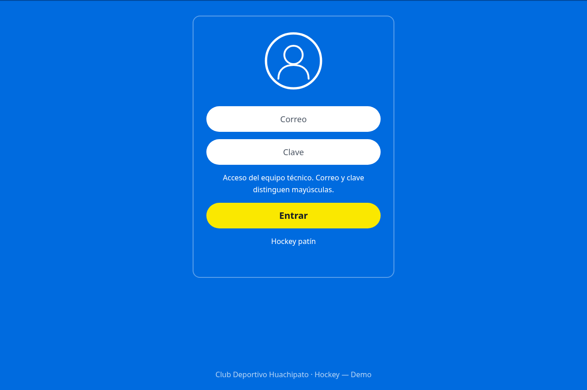
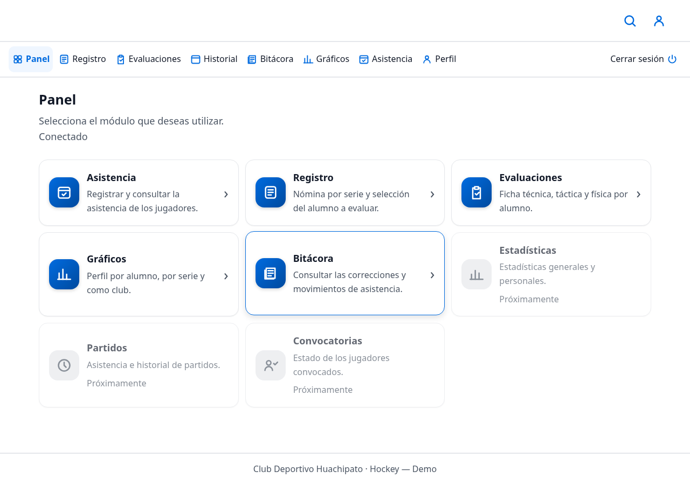
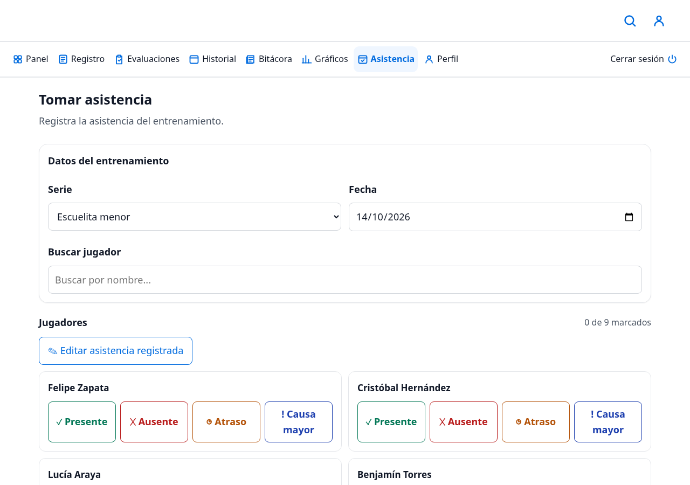
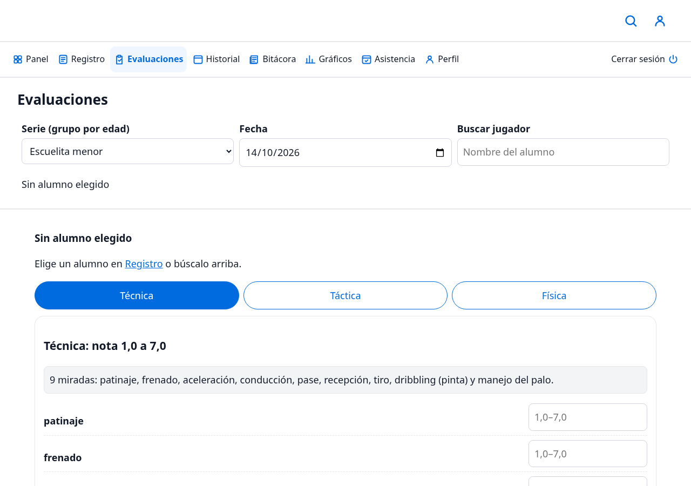
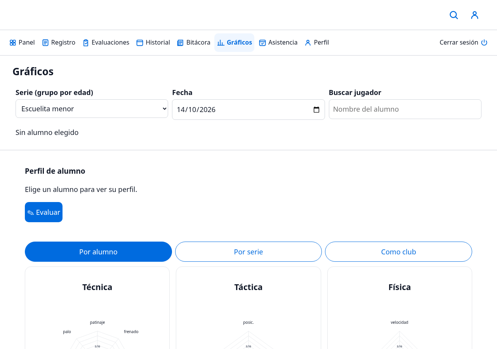
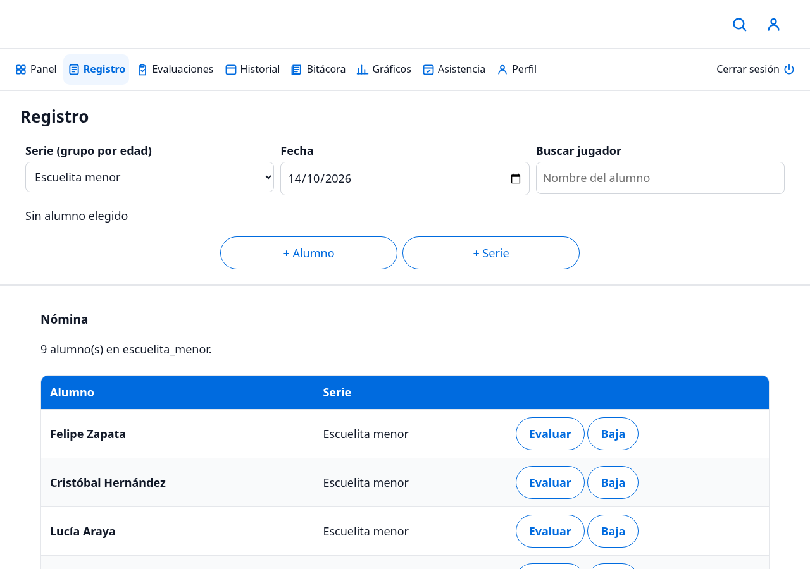

# Huachi Sport — demo con capturas

Capturas de la demo de **Huachi Sport**, sistema de gestión deportiva de la rama de hockey del Club Deportivo Huachipato (Proyecto Integrado INACAP).

El código es privado; este repositorio solo muestra el producto funcionando. **Todos los datos visibles son ficticios y sembrados automáticamente** (series y jugadores de prueba generados con una semilla determinista), no corresponden a personas reales.

## Acceso

| | |
|---|---|
|  | Acceso del equipo técnico. Autenticación con hash de contraseñas (scrypt), comparación en tiempo constante y límite de 5 intentos por minuto por IP. |
|  | Panel principal con los módulos activos y el estado de conexión visible (texto + icono). |

## Operación diaria

| | |
|---|---|
|  | Registro de asistencia del entrenamiento: presente, ausente, atraso o causa mayor por jugador, con edición de una asistencia ya guardada (registro idempotente: guardar dos veces no duplica). |
|  | Ficha de evaluación física, técnica y táctica por alumno, con nota en escala chilena 1,0–7,0 (guardada como entero 10–70 para evitar errores de redondeo). |
|  | Perfil por alumno, por serie y como club (gráficos radiales de técnica, táctica y física). |
|  | Nómina por serie con alta de alumnos y series, y baja lógica (borrado que preserva el historial, nunca físico). |

---

*Stack: TypeScript, PostgreSQL, Vite, Tailwind CSS · pruebas unitarias, de API, integrales, de rendimiento y de seguridad.*
